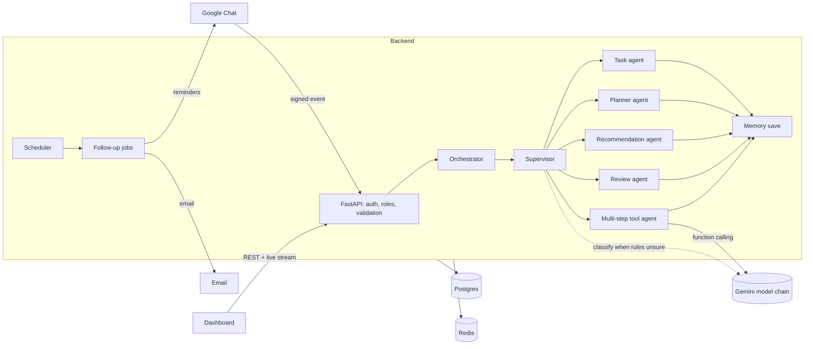
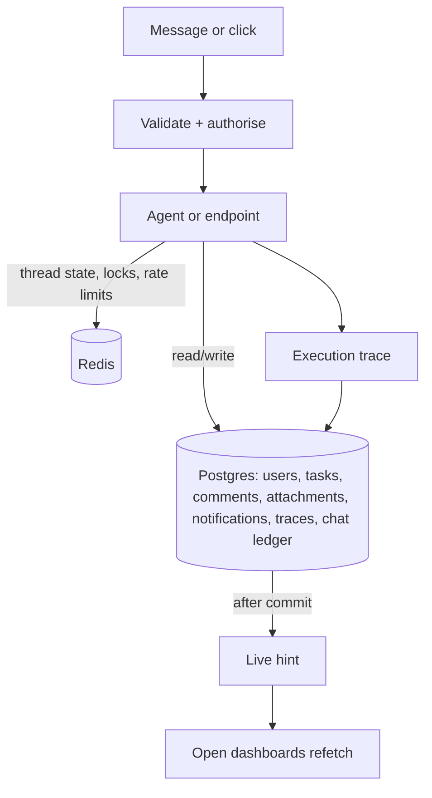

# ORBIT: Architecture Submission

A multi-agent task manager that people use from Google Chat and from a web dashboard. It plans, assigns, reminds and follows up, and it asks before doing anything destructive.

Deeper detail lives in [ARCHITECTURE.md](ARCHITECTURE.md), [AGENTS.md](AGENTS.md), [DATABASE.md](DATABASE.md) and [DECISIONS.md](DECISIONS.md). This page is the short version for review.

## 1. Why this architecture

| Need | Choice | Why |
|---|---|---|
| Users already live in chat | Google Chat bot, plus a dashboard for the visual work | Chat is the fastest way to say "move my overdue tasks to Friday"; the dashboard is better for boards, weeks and admin |
| Requests are very different (a greeting, a bulk change, a week plan) | A supervisor that routes to specialist agents (LangGraph) | Each specialist has a small prompt, a narrow set of tools and a test suite. One giant prompt would be slower, costlier and harder to trust |
| Some requests need several steps ("find overdue tasks and move them") | A tool-using agent that plans and chains tools, with hard limits | The model decides the steps; the code decides what is allowed (ADR-020) |
| Scheduling, assignment and duplicate checks must be explainable and instant | Plain algorithms, not prompts | Same input gives the same output, no API cost, and the reason can be shown to the user (ADR-022) |
| The AI provider can be slow, busy or out of quota | A chain of fallback models, timeouts, a circuit breaker, and rules when no model answers | The app keeps working; the free key's 20-requests-a-day limit stops being a single point of failure (ADR-019, ADR-021) |
| People must stay in control | Confirmation before delete, duplicate warnings, a 10-minute expiry on pending questions | Questions can never change data; destructive actions need an explicit yes |

Stack: FastAPI (async), SQLAlchemy 2 + Postgres, Redis, LangGraph, LiteLLM with Gemini, APScheduler, Next.js 14.

## 2. System view

## 3. How the agents interact

1. **Supervisor** reads the message and decides the intent. Simple intents (help, greeting, my tasks, plan my week, who has room) are recognised by rules and skip the model entirely. Others go to the model for structured classification. If the model is unavailable, rules decide.
2. It then routes to exactly one specialist:
   - **Task agent**: create, update, complete, details. Runs the duplicate check before creating.
   - **Planner agent**: plan my day, and plan my week (algorithm).
   - **Recommendation agent**: workload advice and "who should take this" (algorithm).
   - **Review agent**: confirmations for destructive actions, ambiguity ("which of these two?"), expiry of stale questions.
   - **Multi-step tool agent**: compound or bulk requests. The model chooses from ten tools (search, get, find person, list team, workload, stats, suggest assignee, create, update, complete). There is no delete tool.
3. Every path ends in **memory save**, which stores the thread state so a follow-up such as "mark it done" refers to the right task.

The orchestrator records the ordered steps, which classifier decided, and what changed. The dashboard's "ORBIT activity" page draws that as a workflow, in plain language.

Guardrails on the tool agent:
- At most 6 reasoning steps, 10 changes and 12 seconds per run.
- Role checks happen inside each tool, not only at the API.
- Identical changes in one run are applied once.
- Text found inside tasks is treated as data, never as instructions.
- If the request is unclear (two people with the same name), it asks instead of guessing.

## 4. Communication flow

**Chat request**
1. Google sends a signed event. The API verifies the token (issuer, audience, service-agent identity, small clock tolerance).
2. The event ledger makes it idempotent: Google retries do not run twice; a stuck event is retried safely.
3. The sender is matched to a user by email (case-insensitive) and the role is applied.
4. The orchestrator runs the graph with a 22-second budget, inside Google's 30-second limit. On timeout or model failure the user gets a short, plain message, never an error trace.

**Dashboard request**
1. The browser calls REST with a bearer token. Roles are enforced per endpoint.
2. After each database commit, a hook publishes a small "something changed" hint over server-sent events, and open pages refetch. The hint carries no data, so it cannot leak anything.

**Autonomous follow-ups** (scheduler, no user message)
- Daily briefing, overdue follow-up, due-soon reminders, nudges for stale tasks, and escalation to managers.
- Each job takes a Redis lock, so several instances never send twice.
- Messages go to Google Chat and, where configured, email.

## 5. Data flow

- **Postgres** is the single source of truth. Migrations are versioned (Alembic, 001 to 007). Soft delete keeps history.
- **Redis** holds short-lived things only: conversation checkpoints, locks, rate-limit counters. Losing it never loses tasks.
- **Execution traces** store each run's steps, classifier and changes, for the activity page and for debugging.
- **Data sent to the AI provider** is the user's message and the minimum task text needed for the answer. Passwords, tokens and other users' data are never included, and tools only return what the caller's role may see.

## 6. Scalability and reliability

| Concern | Today | How it grows |
|---|---|---|
| API throughput | Stateless async FastAPI | Add instances behind a load balancer; no sticky sessions needed |
| Conversation state | Redis checkpointer, keyed by thread | Redis cluster or managed Redis |
| Duplicate work across instances | Redis locks on scheduled jobs; chat ledger | Move jobs to a separate worker process; already isolated in `scheduler/` |
| Database | Indexed queries, paginated lists, capped agent reads (25 tasks) | Read replica for dashboards; partition traces by month |
| AI cost and limits | Rules answer common intents; algorithms do planning; fast model for classification | Paid key, per-user rate limits (already present), response caching |
| AI outages | Model chain, per-call timeout, circuit breaker, rules fallback | Add providers behind the same `ModelPool` |
| Live updates | Per-user connection cap, bounded stream lifetime | Swap the in-process publisher for Redis pub/sub when running many instances |
| Observability | Health endpoint, optional Prometheus metrics, traces | Alerting on the health check (UptimeRobot) and on trace error rate |

Known limits, stated plainly:
- The free Render plan sleeps when idle, so the first request after a pause is slow; a monitor on `/health` keeps it awake.
- The free Gemini key is limited to about 20 requests a day per model. Rules and algorithms cover the common requests; the multi-step agent is what uses the quota.
- Live updates are per instance until the publisher moves to Redis.
- Attachments are on local disk; for several instances they should move to object storage.

## 7. Testing

478 backend tests (including real-database API tests, guardrail tests for the tool agent, and classifier datasets) and 40 browser tests (login, tasks, week, activity, accessibility, no technical words on any screen). A script, `backend/scripts/try_tool_agent.py`, runs the multi-step agent against the real model.

---

## 8. Tool evaluation (to be completed by the submitter)

> Reserved for the HiDevs Architecture Copilot output and your own evaluation. Not written by the assistant.

**Diagram produced by the Copilot:**

**Comparison with what was built** (facts checked against the code; edit freely):

| Copilot diagram | As built |
|---|---|
| Five layers: communication, observability and evaluation, orchestration, external AI, data | Same layers; the build adds a scheduler for follow-ups and a tool-using agent beside the fixed specialists |
| Supervisor routes to Task, Planning, Recommendation and Review agents | Same four, plus a multi-step tool agent and a memory step |
| Deterministic tool gateway enforcing roles and validation | Roles are checked in the API and again inside every agent tool |
| Autonomous scheduler "APScheduler / Celery Beat" | APScheduler with Redis locks; no Celery |
| Observability with Prometheus, Grafana, LangSmith, OpenTelemetry | Execution traces in Postgres plus an optional Prometheus endpoint; no Grafana, LangSmith or OpenTelemetry |
| AI evaluation layer (RAGAS, DeepEval) | Classifier and agent evaluation datasets run as tests; no RAGAS or DeepEval |
| Postgres with pgvector | Plain Postgres; no vector search is needed yet |
| LLM gateway over OpenAI, Anthropic and Gemini | LiteLLM with a Gemini model chain and a rules fallback |

**Prompt given to the Copilot:**

_(paste)_

**What the Copilot suggested:**

_(paste)_

**What I accepted, changed or rejected, and why:**

_(write)_

**Gaps the Copilot missed that this document covers:**

_(write)_
